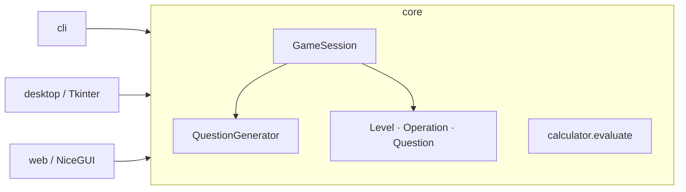

<div align="center">

# 🧮 Maths Frenzy

**A fast-paced mental-maths game and calculator, in your terminal, on your desktop, or in your browser.**


</div>

Beat the clock: 20 questions, 20 seconds each, three difficulty levels and four operations.
Includes a safe built-in calculator. One game engine, three interfaces:

| Interface | Built with | Run it with | Extra install |
| --- | --- | --- | --- |
| **Terminal** | Python standard library | `maths-frenzy cli` | none |
| **Desktop** | Tkinter | `maths-frenzy desktop` | none (Tkinter ships with Python) |
| **Web** | [NiceGUI](https://nicegui.io) | `maths-frenzy web` | `pip install "maths-frenzy[web]"` |

## Features

- **Three levels**: Beginner (numbers up to ±20), Advanced (±50) and Master (±100).
- **Four operations**: addition, subtraction, multiplication and division (answers rounded to 2 decimals).
- **Beat the clock**: a live per-question timer, plus an untimed practice mode in the CLI.
- **Results and review**: score, accuracy, a rank, and the questions you got wrong.
- **Two calculators**: a keypad calculator that evaluates full expressions such as `2 × (3 + 4)`, and a simple two-number one (desktop).
- **Safe by design**: expressions are parsed with a whitelist, never `eval()`ed.
- **Modern UX**: dark desktop theme, responsive web UI with a light/dark toggle, colour terminal output (respects `NO_COLOR`).

## Installation

Requires **Python 3.10 or newer**.

```bash
git clone https://github.com/<your-username>/Maths-Frenzy.git
cd Maths-Frenzy
python -m venv .venv
source .venv/bin/activate          # Windows: .venv\Scripts\activate

pip install .                      # terminal + desktop
pip install ".[web]"               # ...plus the browser interface
```

> **Linux:** if the desktop app says Tkinter is missing, install it with your package
> manager, e.g. `sudo apt install python3-tk` (Debian/Ubuntu) or `sudo dnf install python3-tkinter` (Fedora).

## Usage

```text
maths-frenzy cli       # terminal
maths-frenzy desktop   # desktop window   (alias: gui)
maths-frenzy web       # browser, opens http://127.0.0.1:8080
```

Every interface is also available as its own command (`maths-frenzy-cli`,
`maths-frenzy-desktop`, `maths-frenzy-web`) and via `python -m maths_frenzy <command>`.

### Terminal

```bash
maths-frenzy cli                                   # interactive menu
maths-frenzy cli play -l master -o division        # jump straight into a round
maths-frenzy cli play -n 10 -t 8 -p Ada            # 10 questions, 8 seconds each
maths-frenzy cli play --no-timer                   # practice mode
maths-frenzy cli calc "2 * (3 + 4)"                # one-shot calculator -> 14
maths-frenzy cli calc                              # calculator prompt
maths-frenzy cli howto                             # the rules
```

A round looks like this:

```text
Beginner Addition  |  3 questions  |  20s per question
Type q to quit. Division answers use 2 decimal places.

[1/3] What is 8 + 15?  (20s) > 23
  Correct!
[2/3] What is 9 + 8?  (20s) > 7
  Sorry, the answer was 17.
[3/3] What is 12 + 17?  (20s) >
  Time's up! The answer was 29.

----------------------- Results for Ada ------------------------
  Score:  1 / 3  (33%)
  Rank:   Keep Practising

  Review
   9 + 8 = 17   (you: 7)
   12 + 17 = 29   (you: no answer)
----------------------------------------------------------------
```

Tip: to evaluate an expression that starts with a minus sign, put `--` first:
`maths-frenzy cli calc -- "-5 + 3"`.

### Desktop

`maths-frenzy desktop` opens the Tkinter app: main menu → pledge → new game
(nickname, level, operation) → play → results. A calculator pop-up is available during a game.

### Web

```bash
maths-frenzy web                          # http://127.0.0.1:8080
maths-frenzy web --port 3000 --no-browser
maths-frenzy web --host 0.0.0.0           # share on your local network
```

Every browser tab is an independent game, so several people can play against one server.

## How to play

1. Pick a **level** and an **operation**.
2. Answer 20 questions. You get 20 seconds for each one.
3. Type your answer and press **Enter**. Division answers are compared at two decimal places
   (so `0.333` is accepted for `1 ÷ 3`).
4. Check your score, accuracy and rank, then review the ones you missed.

| Accuracy | Rank |
| --- | --- |
| 90%+ | Maths Wizard |
| 70%+ | Sharp Mind |
| 50%+ | Getting There |
| below 50% | Keep Practising |

## Project structure

```text
Maths-Frenzy/
├── src/maths_frenzy/
│   ├── core/                 # Game logic. Pure Python, no third-party or GUI imports.
│   │   ├── models.py         #   Level, Operation, Question
│   │   ├── questions.py      #   Random question generator
│   │   ├── session.py        #   GameSession state machine, config, results, ranks
│   │   ├── calculator.py     #   Safe expression evaluator and two-number calculator
│   │   ├── numbers.py        #   Parsing and formatting of numbers
│   │   └── content.py        #   Shared UI copy (rules, tutorial text, credits)
│   ├── interfaces/
│   │   ├── cli/              #   Terminal interface (stdlib only)
│   │   ├── desktop/          #   Tkinter interface (screens, theme, keypad widget)
│   │   └── web/              #   NiceGUI interface
│   ├── launcher.py           # The `maths-frenzy` command
│   └── __main__.py           # python -m maths_frenzy
├── tests/                    # Unit tests for core, CLI and launcher
├── .github/workflows/ci.yml  # Lint + tests on Linux, Windows and macOS
├── pyproject.toml
├── CHANGELOG.md
├── CONTRIBUTING.md
└── LICENSE
```

**Design principle:** interfaces never contain game rules. A `GameSession` owns the questions,
score and history; an interface just renders it and calls `submit(answer)` or `time_out()`.
That is why the three front-ends behave identically, and why the logic is easy to test.



## Development

```bash
pip install -e ".[web,dev]"

pytest            # run the tests
ruff check .      # lint
ruff format .     # format
mypy              # type-check the core
```

Want to add a fourth interface (a Telegram bot, a REST API...)? Import from `maths_frenzy.core`,
create a `GameSession`, and you have the whole game. See [CONTRIBUTING.md](CONTRIBUTING.md).

### Building a standalone Windows executable

The repository no longer ships a pre-built `.exe` (binaries don't belong in git). To build one:

```bash
pip install pyinstaller
pyinstaller --onefile --windowed --name MathsFrenzy --paths src src/maths_frenzy/interfaces/desktop/__main__.py
```

The result is in `dist/MathsFrenzy.exe`. Attach it to a GitHub Release.

## License

Released under the [MIT License](LICENSE).

Follow ABC Apps on Instagram [@abc_apps_official](https://instagram.com/abc_apps_official) or on Facebook (ABC apps).
